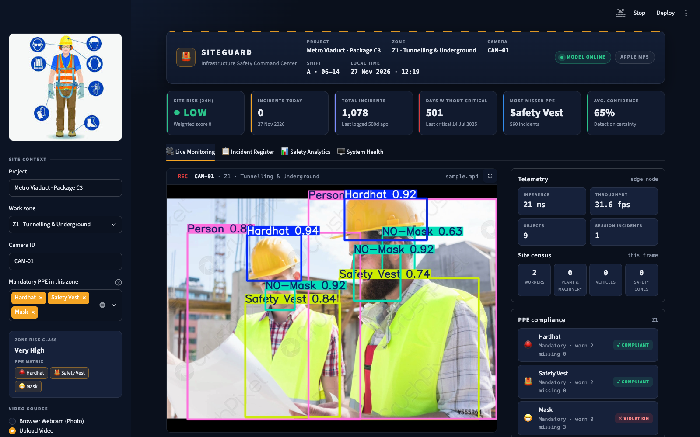
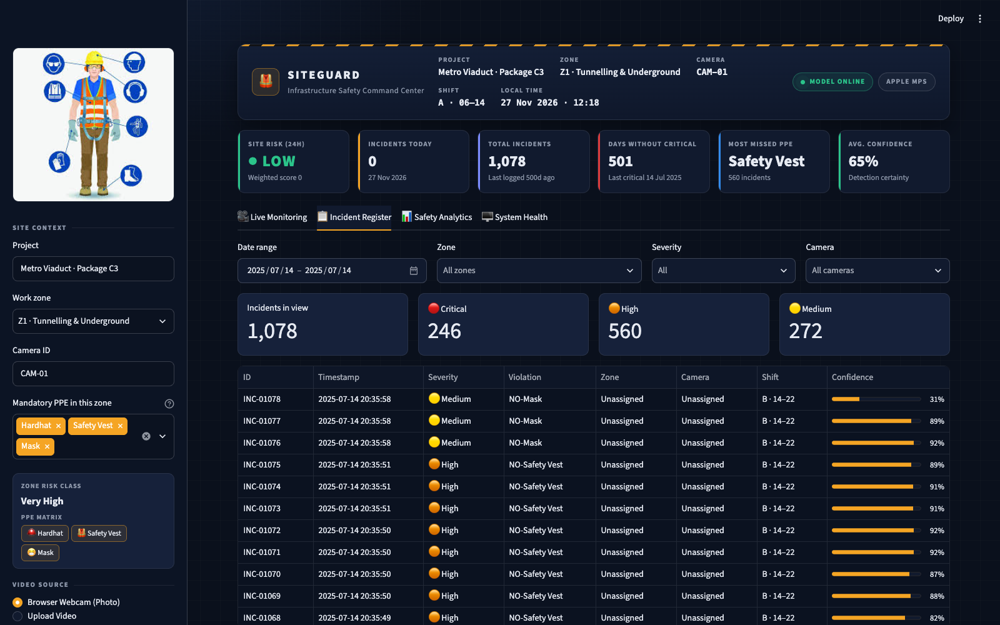
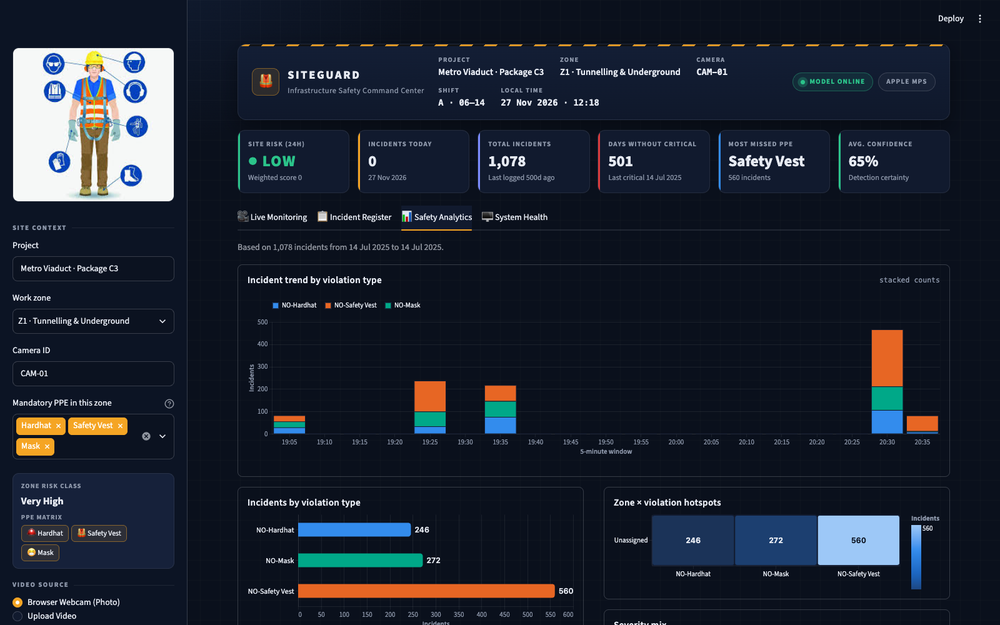
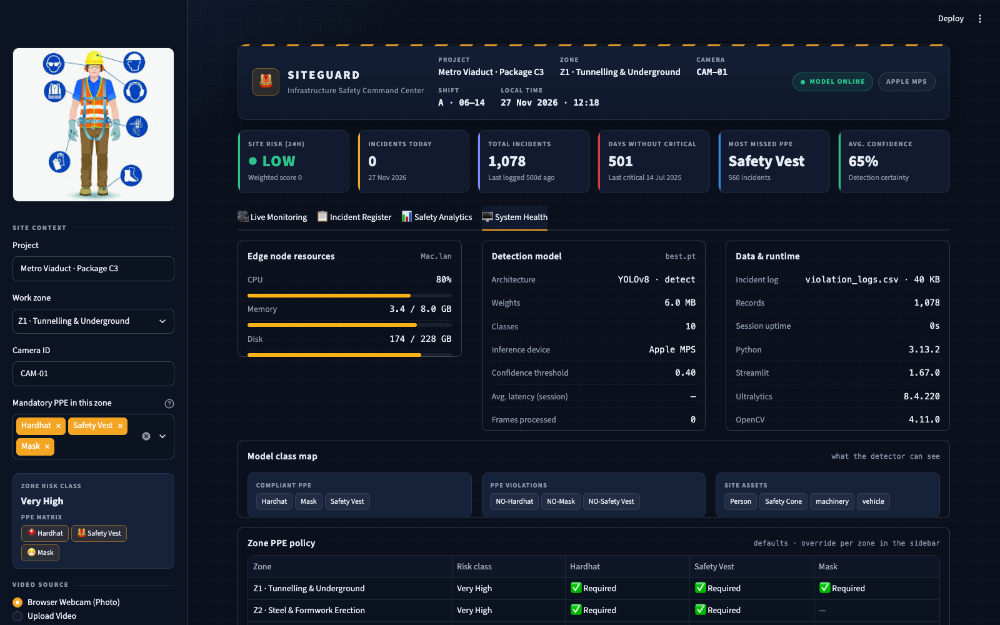

# 🛡️📹 AI-Powered Industrial Safety Surveillance System
---

**Category:** Industry Defined Problem   |  **Organization:** Jyoti CNC Automation, Rajkot 

> 🍴 **Fork notice:** This is a fork of [darshan1654/AI-PPE-Detection](https://github.com/darshan1654/AI-PPE-Detection) with a redesigned **SiteGuard** dashboard for infrastructure sites. See [What's New in This Fork](#-whats-new-in-this-fork). The screenshots directly below show the original UI.

 

---

## 📄 Project Overview

This project integrates **AI-powered Personal Protective Equipment (PPE) detection** and **CCTV-based Anomaly Surveillance** into a single real-time system. It is designed to improve **Workplace Safety**, **Regulatory Compliance**, and **Operational Efficiency** in industrial environments.

Using advanced **Deep Learning models** and **Computer Vision**, the system ensures that workers adhere to safety protocols and that unusual or unsafe activities are promptly flagged.

---

## ✅ Key Features

### 👷 PPE Detection Module
- Real-time detection of:
  - 🪖 Helmets  
  - 😷 Face Masks  
  - 👷 Safety Vests  
  - 🧤 Gloves  
- Supports live feed from **Webcam/IP Camera**
- Upload and analyze **Video/Image files**
- Detection logs with timestamps and confidence scores

### 📹 CCTV Anomaly Detection Module
- Real-time detection of:
  - 🚫 Entry into restricted zones  
  - ⚠️ Safety violations (e.g., no helmet, improper behavior)  
  - 🚷 Suspicious or unsafe movements  
- Continuous monitoring via CCTV/IP camera
- Alert generation on detection

### 📊 Dashboard (Built with Streamlit)
- Live status feed with detection results
- Real-time preview of camera feed
- Violation and compliance logs
- Summary statistics and compliance reports
- KPI summary cards for total violations, today's count, most common violation and average confidence

---

## ✨ What's New in This Fork

### 🦺 SiteGuard: Infrastructure Safety Command Center
The dashboard is reorganised around how infrastructure projects (metro, bridges, tunnels, highways) actually manage safety: **work zones, cameras, shifts and an incident register**.



#### Site context & PPE policy (sidebar)
- **Project, work zone and camera ID**: every incident is tagged with where it happened
- **Six default work zones** (Tunnelling, Steel & Formwork Erection, Foundation & Piling, Batching Plant, Road Works, Material Yard), each with a risk class and a **zone PPE matrix**
- Only missing **mandatory** PPE for the zone is logged as an incident; optional misses show as advisories
- **Detection policy:** confidence threshold, alert cooldown (so one worker isn't logged on every frame) and frame skipping for edge devices

#### 🎥 Live Monitoring
- Camera tile with REC / STANDBY state, zone and source
- **Telemetry:** inference latency, throughput (fps), objects, session incidents
- **Site census:** workers, plant & machinery, vehicles and safety cones in frame
- **PPE compliance board:** each item shows Compliant / Violation / Advisory / Not seen
- **Alert feed** of the latest incidents
- One-click **Run bundled sample.mp4** demo; RTSP credentials are masked on screen

#### 📈 KPI row
| Tile | Shows |
|------|-------|
| Site Risk (24h) | LOW / MODERATE / HIGH / SEVERE from a severity-weighted score |
| Incidents Today | Incidents logged today |
| Total Incidents | All incidents and how long ago the last one was logged |
| Days Without Critical | Days since the last missing-hardhat incident |
| Most Missed PPE | The most frequently missing item |
| Avg. Confidence | Mean detection confidence |

#### 📋 Incident Register

- Filter by date range, zone, severity and camera
- Severity is based on the hazard: 🔴 **Critical** (no hardhat), 🟠 **High** (no hi-vis vest), 🟡 **Medium** (no mask)
- Incident IDs, shift (A 06–14 · B 14–22 · C 22–06), confidence bars
- Export the filtered register as CSV; clearing the register requires confirmation

#### 📊 Safety Analytics

- Incident trend stacked by violation type (time buckets adapt to the data range)
- Incidents by type, zone × violation hotspot heatmap, hour-of-day profile with shift bands, severity mix

#### 🖥️ System Health

- Edge node CPU, memory and disk
- Model details, the inference device in use (CUDA / Apple MPS / CPU, picked automatically), session latency and frames processed
- Runtime versions, the model class map and the zone PPE policy table

#### Under the hood
- The model is cached with `st.cache_resource` and is no longer reloaded on every interaction
- The incident log gains `Zone`, `Camera`, `Shift` and `Severity` columns. Old 3-column logs still load and are upgraded automatically on the next write
- Fixed a merge-conflict marker in `violation_logs.csv` that left the dashboard showing no data
- Live metrics update in place instead of stacking new widgets on every frame

---

## 📦 Tech Stack

| Component       | Technology         |
|----------------|--------------------|
| 💡 AI Model     | YOLOv8 (Ultralytics) |
| 🧠 Backend       | Python, OpenCV     |
| 🌐 Frontend/UI  | Streamlit          |
| 🎥 Video Input  | Webcam/IP Camera   |
| 📊 Data Logging | Pandas, CSV Logs   |

---

## 🏭 Industrial Benefits

- ✅ Automated compliance with PPE policies  
- 🔍 Real-time safety monitoring  
- 📉 Reduced accident risk and manual supervision  
- 📊 Actionable insights from safety data  

---

## 📸 Sample Outputs

- 📷 Detected image with PPE boxes  
- 🧾 Logs with timestamp and violation type  
- 📈 Streamlit dashboard with real-time updates  

---

## 🔧 Installation & Setup

```bash
# 1. Clone the repository
git clone https://github.com/thisisvikas21/AI-PPE-Detection.git
cd AI-PPE-Detection

# 2. Create and activate a virtual environment
python -m venv venv
source venv/bin/activate  # or venv\Scripts\activate on Windows

# 3. Install required dependencies
pip install -r requirements.txt

# 4. Run the application
streamlit run app.py
```

---

## 📁 Project Structure

```
├── .streamlit/
│   └── config.toml      # Dark theme settings
├── docs/screenshots/    # README screenshots
├── app.py               # Streamlit app (SiteGuard dashboard)
├── best.pt              # YOLOv8 model files
├── yolov8n.pt           # YOLOv8 model files
├── violation_logs.csv   # Detection logs CSV file
├── requirements.txt     # Dependencies
├── packages.txt         # packages
└── runtime.txt          # For deployment (e.g., Heroku)
```

---

## 👨‍💻 Team Details

**Group ID:** G00171

| Name             | Email                                                                       |
| ---------------- | --------------------------------------------------------------------------- |
| Kushal A. Parekh | [22ce113@svitvasad.ac.in](mailto:22ce113@svitvasad.ac.in)                   |
| Darshan Pardeshi | [darshanpardeshi1654@gmail.com](mailto:darshanpardeshi1654@gmail.com)       |
| Param V. Jani    | [janiparam61@gmail.com](mailto:janiparam61@gmail.com)                       |
| Darshan Panchal  | [mpdarshanpanchal001031@gmail.com](mailto:mpdarshanpanchal001031@gmail.com) |
| Jaymin Raval     | [ravaljaymin2908@gmail.com](mailto:ravaljaymin2908@gmail.com)               |

---

## 🔮 Future Scope

* 🔔 Voice/Email/SMS alert system
* 🔗 Integration with ERP systems
* 📊 Admin dashboard with analytics
* 📤 Auto-upload violation clips
* 📡 Multi-location camera support

---

## 🏆 Achievements

* ✅ Used in **Real Industrial setup** at Jyoti CNC
* 🎓 Presented at **College-level expo**
* 📡 Successfully tested with **Live Camera feeds**

---

## 📜 License

For **Academic and Research use** only.

---

## 🙏 Acknowledgements

* [Ultralytics YOLOv8](https://github.com/ultralytics/ultralytics)
* [OpenCV](https://opencv.org)
* [Streamlit](https://streamlit.io)
* Jyoti CNC Automation Pvt. Ltd.
* SVIT Vasad

---

## 📬 Contact

📧 [janiparam61@gmail.com](mailto:janiparam61@gmail.com)
📧 [darshanpardeshi1654@gmail.com](mailto:darshanpardeshi1654@gmail.com)
📧 [22ce113@svitvasad.ac.in](mailto:22ce113@svitvasad.ac.in)
📧 [mpdarshanpanchal001031@gmail.com](mailto:mpdarshanpanchal001031@gmail.com)
📧 [ravaljaymin2908@gmail.com](mailto:ravaljaymin2908@gmail.com)


---
